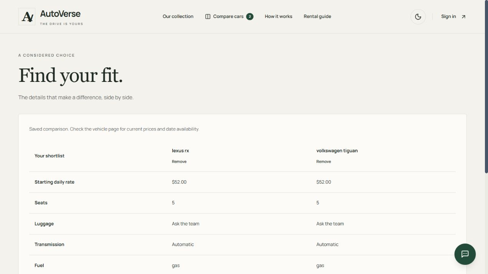

# System review — 2 November 2026

## Before merging the platform upgrade

The review covered booking allocation, branch stock, cancellation, collection/return, payment settlement, review eligibility, public browsing, comparison, chat, authentication boundaries and rendering behavior.

### Corrections

- VERO's previous Gemini model returned `404` for the configured account. The default now uses `gemini-3.5-flash-lite`; an unavailable configured model falls back once. Replies use structured output and only known inventory IDs. Timeout, quota, malformed reply and retry states are handled. Analytics failures cannot discard a valid answer. Conversations are scoped to the signed-in account; a guest's draft survives the sign-in redirect.
- Checkout creation now rechecks the locked reservation after the external gateway returns. A cancellation or expired hold cannot be revived by a late checkout response. The session is retained for webhook reconciliation, expired when possible, and late payment enters the refund queue.
- Cancellation retries are idempotent. Staff cannot collect a rental whose scheduled period has ended or complete an unassigned rental. A late return cannot consume another reservation's preparation time silently. An overdue active unit cannot be taken offline without resolving its reservations.
- Booking, review, staff status and fleet actions return readable business errors in production. Infrastructure errors are redacted. Availability responds with appropriate validation, rate-limit and temporary-outage statuses.
- Booking quotes are tied to their exact car, branch and dates; an older quote cannot enable submission after the inputs change. An unsupported branch now requires an explicit replacement selection.
- Comparison data is validated before rendering. Corrupted storage, duplicate cars, invalid prices, blocked browser storage and malformed optional fields cannot crash the comparison flow. Other tabs update the count and shortlist.
- CI applies every migration to a new PostgreSQL database and runs types, policy tests, chat workflows, media storage and business integration tests without application secrets.

### Evidence

- `npm test`: 27 passing tests.
- `npm run test:chat`: 5 passing HTTP/provider workflow tests.
- `npm run test:media`: 1 passing storage integration test.
- `RUN_DB_TESTS=1 npm run test:inventory`: 10 passing tests, including the four production-service lifecycle scenarios under their parent test. Fixtures use random IDs and are removed afterward. No emails were delivered and no Stripe API transactions were performed.
- `npm run typecheck` and `npm run build`: passed.
- `npm audit --omit=dev`: zero reported vulnerabilities.
- GitHub Actions independently passed the complete migration chain and all configured checks against fresh PostgreSQL.
- A live Gemini request with actual database inventory returned a nonempty answer and known recommendation IDs. The previous configured model's `404` and the replacement model's successful response were reproduced.
- Built-site browser checks: public catalogue and vehicle detail; multi-angle gallery controls; add/remove comparison and navigation count; mobile comparison at 390 × 844 in both themes without document overflow; native pickup changes automatically set a later return and minimum; server quote and available-unit count; VERO guest sign-in redirect with draft retained. No browser console errors were observed in this pass.
- HTTP checks: unauthenticated chat and maintenance return `401`; unsigned Stripe webhook returns `400`; malformed availability dates return a readable `400`.

The browser did not have a signed-in staff/customer session. Full authenticated UI journeys and external Stripe webhook delivery are not claimed as end-to-end verified. The actual business services are covered against PostgreSQL; external chat failure modes and HTTP flows use controlled provider fixtures. The inherited `next lint` command remains unsupported and is not counted as a check.

### Configuration

No new database migration is introduced by this review. The platform upgrade includes the two existing October inventory/branch migrations. A deployment must apply them using the company's migration procedure, configure its Clerk account, select its image store, and schedule `/api/maintenance` with `CRON_SECRET`. Stripe remains sandbox-only. See [deployment requirements](PLATFORM_UPGRADE.md) and [image storage](BRANCHES_IMAGES_AND_USAGE.md).

Google references: [model lifecycle](https://ai.google.dev/gemini-api/docs/deprecations), [Flash-Lite model](https://ai.google.dev/gemini-api/docs/models/gemini-3.5-flash-lite), [structured output](https://ai.google.dev/gemini-api/docs/structured-output). The old model's failure was account-specific; this review does not claim it was globally retired.

## After-merge review

This pass started after PR #2 merged into `main` at `c3735f8`. It reviewed the merged implementation as a single-company rental product, including server authorization, customer consent, operational reporting, staff feedback, query sizes, data integrity and deployment dependencies.

### Further fixes

- A price change between quote and booking now requires fresh customer confirmation. The accepted quote is checked under the inventory lock; an existing booking retry retains its agreed price. A PostgreSQL service test proves both behaviors.
- Cars, orders and users now load 20 records per page, with stable ordering, retained search filters, result counts and bounded page input. Invalid analytics dates and malformed page URLs no longer cause database query failures. Analytics date filters use UTC consistently.
- Admin dashboard, car listing, order listing, and car edit/create pages authorize before their own queries, in addition to the layout and mutation checks.
- Car, branch, profile, favorite and review moderation mutations return safe business errors. Staff toggles roll back and display failures; role/profile actions recover pending state. Rental status errors appear inline. Successful car save redirects remain outside error handling.
- Role changes and profile deletions lock administrator rows in a consistent order and recheck the actor after waiting. Concurrent administrators cannot revoke each other into an empty staff account set. Database tests exercise simultaneous demotions and deletions, self-protection and rental-history retention.
- The profile-deletion text now matches the server: rental history is retained, profiles with orders cannot be deleted, and deleting an application profile does not revoke its Clerk identity.
- Dashboard booked value and average booked rental exclude pending/cancelled orders. The UI explains that booked value is not settled revenue and that Stripe activity is sandbox-only. Archived cars are excluded from listing totals. Recent chat statistics identify their 100-message sample and respect the selected period. Unused top-car queries and an unused Gemini SDK dependency were removed.
- Admin car thumbnails use the same image selection/fallback as customer listings. A global dark-theme rule no longer darkens the toggle knob into its background.
- Synchronized table scrollbars no longer interrupt the arrow buttons' smooth scrolling. The browser reproduced the original failure and confirmed movement to the far edge after the correction.

### Engineering verification and limits

The expanded suite has 29 unit/policy tests, 5 chat workflow tests, 1 media integration test and 12 PostgreSQL integration test results: **47 passing results**, with none skipped in the authorized database run. Type checking and the production build were repeated for the final code. No migration, seed reset, actual charge or email delivery was needed for this pass.

Admin component QA used an isolated, development-only page containing synthetic data. It verified desktop scrolling, error display and optimistic rollback when authorization is denied, retained pagination search links, disabled deletion for a profile with rental history, and mobile cards in both themes. At 390 px, document width stayed within the viewport. The temporary page was removed before the final build; it never read customer data or bypassed staff authentication. Authenticated end-to-end acceptance testing remains a release check for the operator's configured accounts.

Read-only development data checks found 49 listings and 50 physical units, no invalid seat counts or nonpositive rates, and a validated PostgreSQL overlap exclusion constraint. **One pre-upgrade booking still requires staff vehicle reconciliation.** The review did not invent stock or alter that booking to hide the conflict.

### Business-owner handover

| Area | Current position | Required before a company rollout |
| --- | --- | --- |
| Fleet accuracy | Physical stock and overlaps are protected; one legacy assignment remains flagged | Reconcile the flagged booking against actual fleet records; verify seats, tags and photographs |
| Operating configuration | Local chat and email credentials are present; local scheduler secret, Stripe sandbox webhook and persistent photo storage are absent | Configure each required service in the target environment and verify actual delivery/storage/recovery; local configuration does not establish production configuration |
| Payments and reporting | Sandbox Checkout and refund recovery are implemented; booked value is distinguished from income | Agree how cash/card payments at collection, deposits, damage charges, taxes and refunds are recorded; a real-payment release needs its own acceptance tests |
| Company deployment | Multiple customers and staff share one operator's fleet, with server-side roles and database concurrency protection | Use company-owned identity/storage/domain accounts, establish backups and restore checks, monitoring and staff access procedures; test expected traffic in staging |
| Product commitments | Collection and return are staff actions; rescheduling/extensions require staff arrangements | Supply the operator's final pricing, mileage, protection, eligibility, pickup/support and privacy/retention policies; do not sell placeholder copy as settled business terms |
| Multiple companies | The schema has no tenant boundary | Deploy separate isolated company databases/accounts, or implement and test tenant isolation before offering one shared multi-company service |

The reviewed core is suitable for continued development and a configured demonstration. Commercial readiness depends on those concrete operator checks and authenticated acceptance testing. The audit makes no claim that all possible defects or capacity limits have been eliminated. Longer-term features remain in the [platform roadmap](PLATFORM_UPGRADE.md#further-product-work).

Component QA screenshots use synthetic preview data: [desktop light](screenshots/admin-review-desktop-light.png), [mobile light](screenshots/admin-review-mobile-light.png), [mobile dark](screenshots/admin-review-mobile-dark.png).
